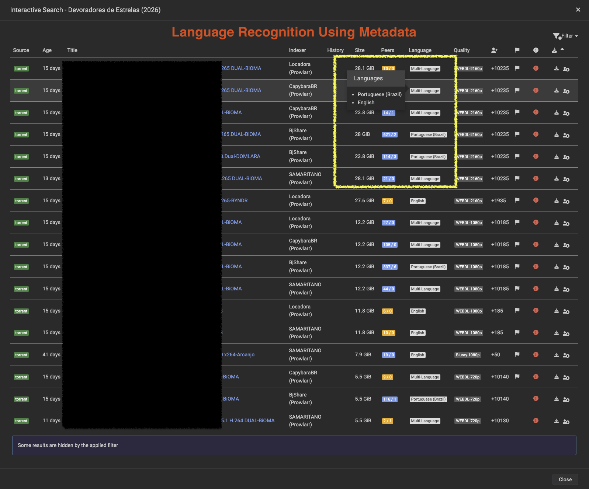
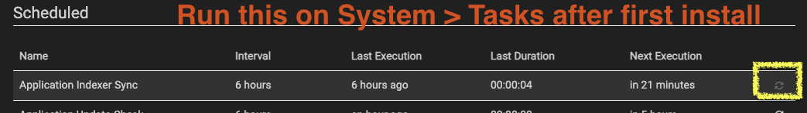
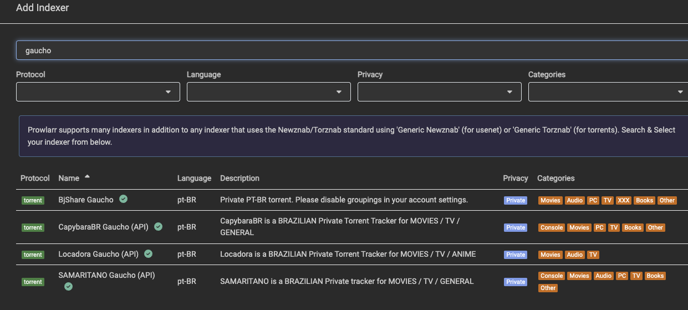

# Prowlarr Gaucho

This is a fork of [Prowlarr](https://github.com/Prowlarr/Prowlarr), the indexer manager/proxy from the \*arr stack. It is not the official project, and it doesn't try to be.

## Why this fork exists

Prowlarr is careful about what it merges, and for good reason: it serves a lot of people, and every indexer definition and parser change has to hold up at scale. That caution means some features and indexer fixes take a long time to land, and some never do.

I'd rather Prowlarr stayed ambitious and forward-thinking than slow down for the things I need today. So instead of asking upstream to move faster, this fork keeps pace with upstream stable releases and layers a few things on top, then drops its copy when upstream merges the change properly. That makes it an open-minded version of Prowlarr for changes that upstream won't merge, or hasn't merged yet. If it works for you, great. If not, the official Prowlarr is one `docker pull` away.

## What this fork adds

With this fork you can get the following results.


### Cardigann language & subtitle metadata

The `cardigann/langsubs` changes add support for parsing `languages` and `subs` fields from Cardigann indexer definitions into release metadata. The interactive search screenshot above shows why this matters: you can see at a glance which release is Portuguese (Brazil) and which is English.

### Cardigann mergeheader

The `gmcouto/mergeheader` changes add support for the `mergeheader` field in Cardigann definitions. Some indexers group torrents under section headers (audio or edition labels, for example), and the metadata you want lives in that header row, not in the torrent's own `<tr>`. `mergeheader` merges the closest preceding header row into each torrent row before parsing, so selectors can reach it.

### Custom indexers (updated automatically)

Extra Cardigann indexer definitions live in the separate [Prowlarr-Gaucho-Indexers](https://github.com/gmcouto/Prowlarr-Gaucho-Indexers) repository, on the `v11` branch. They are not bundled in the Docker image; Prowlarr downloads and updates them on its own through the definitions sync task.

| File | Indexer |
|------|---------|
| [`bjshare_gaucho.yml`](https://github.com/gmcouto/Prowlarr-Gaucho-Indexers/blob/v11/bjshare_gaucho.yml) | BjShare Gaucho (disable grouping on site for this to work) |
| [`brasiltracker_gaucho.yml`](https://github.com/gmcouto/Prowlarr-Gaucho-Indexers/blob/v11/brasiltracker_gaucho.yml) | BrasilTracker Gaucho |
| [`capybarabr_gaucho.yml`](https://github.com/gmcouto/Prowlarr-Gaucho-Indexers/blob/v11/capybarabr_gaucho.yml) | CapybaraBR Gaucho (API) |
| [`locadora_gaucho.yml`](https://github.com/gmcouto/Prowlarr-Gaucho-Indexers/blob/v11/locadora_gaucho.yml) | Locadora Gaucho (API) |
| [`samaritano_gaucho.yml`](https://github.com/gmcouto/Prowlarr-Gaucho-Indexers/blob/v11/samaritano_gaucho.yml) | SAMARITANO Gaucho (API) |

## Releases

Releases use the same version numbers as upstream Prowlarr, since the code is upstream's plus a small set of changes. The latest one is on the [Releases](../../releases) page.

## Deploying with Docker

Pull the image, replacing the tag if you want to pin a version:

```bash
docker pull ghcr.io/gmcouto/prowlarr-gaucho:latest
```

Or with docker compose:

```yaml
services:
  prowlarr:
    image: ghcr.io/gmcouto/prowlarr-gaucho:latest
    container_name: prowlarr
    environment:
      - PUID=1000
      - PGID=1000
      - UMASK=002
    ports:
      - "9696:9696"
    volumes:
      - ./config:/config
    restart: unless-stopped
```

The image is Alpine-based and multi-arch (amd64 and arm64). `PUID`, `PGID`, and `UMASK` control the user the app runs as and the permissions it writes; the defaults match most single-user setups. For `docker run`, the same environment variables apply:

```bash
docker run -d \
  --name prowlarr \
  -p 9696:9696 \
  -v ./config:/config \
  -e PUID=1000 -e PGID=1000 -e UMASK=002 \
  --restart unless-stopped \
  ghcr.io/gmcouto/prowlarr-gaucho:latest
```

The web UI is on port 9696.

### Update your indexer definitions after first install

It is good for you to update your indexer definitions after first install so you can get the `_gaucho` definitions. Run the Application Indexer Sync task under System > Tasks.


Then you can add an indexer using the definitions to your app:


## How releases are built

1. A scheduled workflow checks [Prowlarr/Prowlarr](https://github.com/Prowlarr/Prowlarr) for new stable releases (pre-releases are skipped).
2. When a new version appears, its tag is merged into `master`, then the feature branches are merged in on top.
3. A push to `master` triggers the build: frontend, musl backend for x64 and arm64, a multi-arch Docker image, a `v<version>` tag, and a GitHub release.

If a merge conflicts, the workflow stops and opens an issue instead of pushing anything. Conflicts get resolved by hand, not by forcing one side.

## Repository branches

| Branch | Purpose |
|--------|---------|
| `master` | Shippable code: upstream stable + the changes below, and what the Docker image builds from |
| [`gmcouto/infra`](../../tree/gmcouto/infra) | Docker image and build workflow overlay |
| [`cardigann/langsubs`](../../tree/cardigann/langsubs) | Cardigann language/subtitle feature |
| [`gmcouto/mergeheader`](../../tree/gmcouto/mergeheader) | Cardigann mergeheader feature |
| `disclaimer` | Old default branch, kept for history |

## Upstream

This fork wouldn't exist without the Prowlarr team's work. All credit for the core application goes to them and the wider \*arr community.

- **Source:** https://github.com/Prowlarr/Prowlarr
- **Docs:** https://wiki.servarr.com/prowlarr

Please don't report this fork's issues to upstream Prowlarr; report them [here](../../issues).

### License

- [GNU GPL v3](http://www.gnu.org/licenses/gpl.html)

Icon credit: [Box vector created by freepik - www.freepik.com](https://www.freepik.com/vectors/box)
